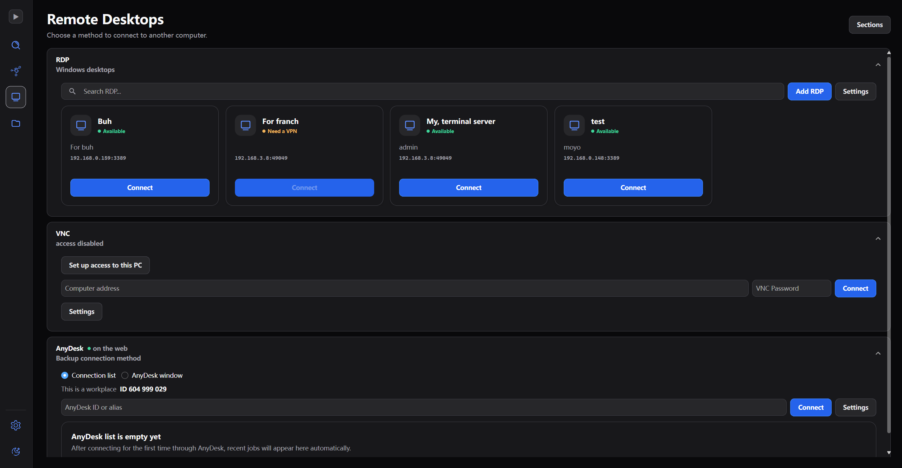
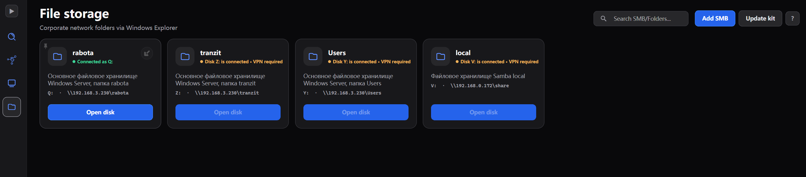
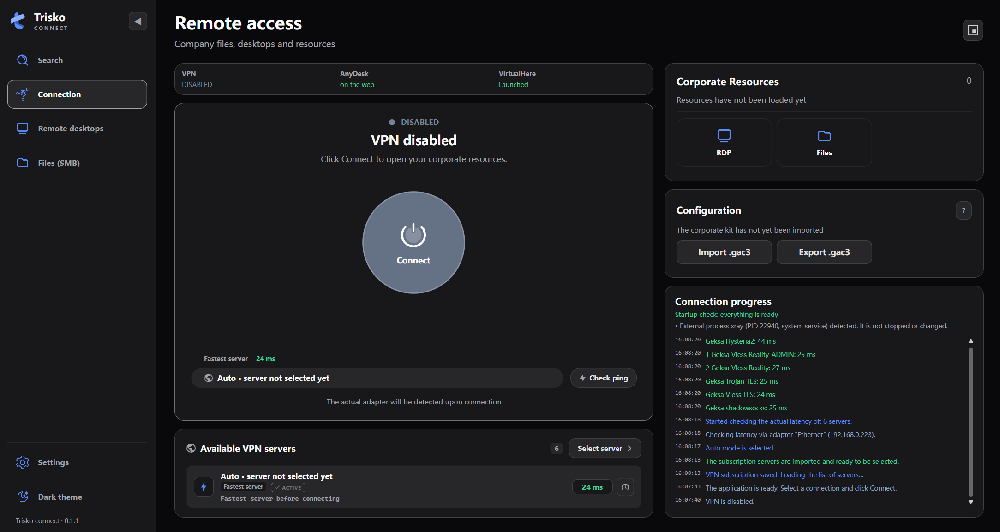
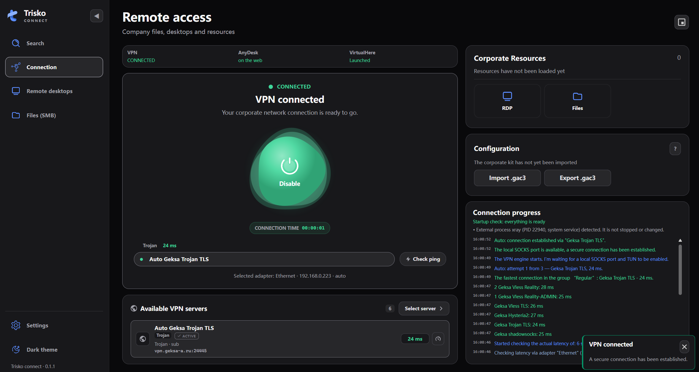
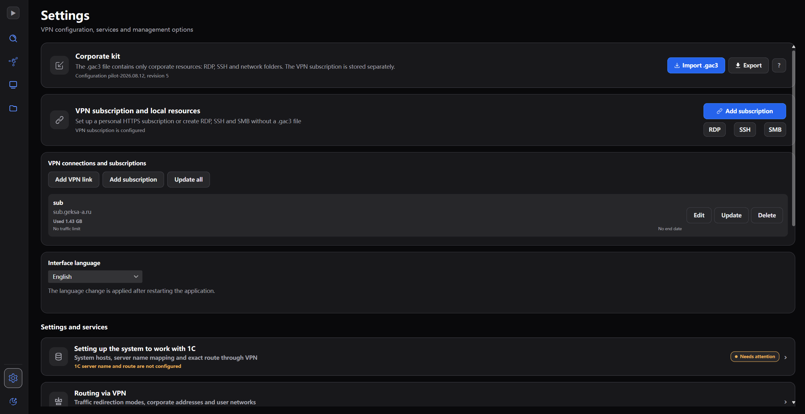
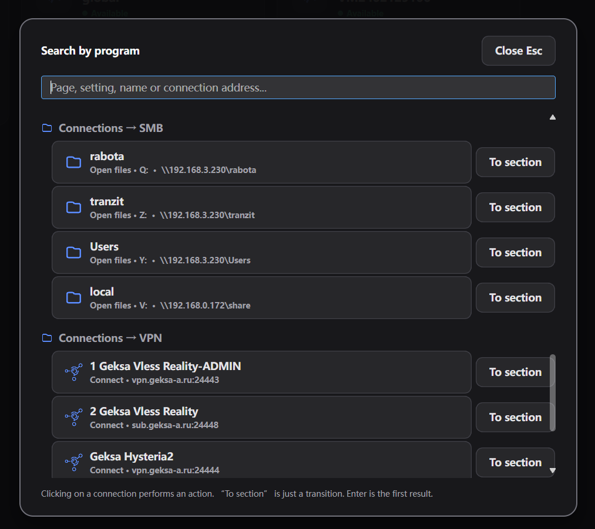

<div align="center">
  
  <h1>Trisko connect</h1>
  <p><strong>Your company resources. One workspace.</strong></p>
  <p>Shared files, remote desktops, servers and digital signature devices — together in a Windows application.</p>
  <p>
    
    
    <a href="LICENSE"></a>
    <a href="https://github.com/S-Hov/Trisko-connect/actions/workflows/validate.yml"></a>
  </p>
  <p><a href="#english">English</a> · <a href="#русский">Русский</a> · <a href="#screenshots">Screenshots</a> · <a href="#build--run">Build &amp; run</a></p>
</div>

---

<a id="english"></a>

## Corporate access, brought together

Trisko connect gives employees and administrators one place to open company files, connect to work computers, reach servers and use remote USB signature tokens. Add individual resources, pin the ones you use most, or import a shared resource bundle.

**VPN is an optional connection layer, not the purpose of the application.** Use resources directly when your network can reach them; connect to a private company network when needed.

| Your task | In Trisko connect |
| :--- | :--- |
| Open company files | SMB shares and mapped Windows drives |
| Work on another computer | RDP desktops and VNC sessions |
| Help a colleague | Direct AnyDesk connections |
| Administer a server | SSH through the system client |
| Use a remote signature token | Digital signature devices and USB access through VirtualHere |
| Reach a private network | Standalone VPN profiles and multiple independent subscriptions |

### Made for everyday work

- **A reusable workspace.** Favorites, pinned resources and connection search keep frequently used destinations close.
- **Individual resources or shared bundles.** Add RDP, SSH and SMB connections manually, or import and export resource sets as `.gac3`.
- **Optional automation.** Open selected resources and manage network drives when a VPN connects or disconnects.
- **A choice of appearance.** English and Russian interfaces, with blue, dark and light themes.
- **Separate VPN configuration.** Named subscriptions have their own servers, traffic information, update and removal actions. Standalone profiles do not require a subscription.

<a id="screenshots"></a>

## Screenshots

### Remote desktops & assistance

RDP workstations, VNC and AnyDesk are available from the same section.



### Shared files & network drives

Company folders are presented as connection cards with availability and drive status.



<details>
<summary><strong>Workspace overview — before and after connecting</strong></summary>

The main page brings together network status, available resources and connection progress.





</details>

<details>
<summary><strong>Settings, resource bundles & subscriptions</strong></summary>

Manage resource bundles, individual connections, VPN subscriptions, language and integrations.



</details>

<details>
<summary><strong>Search across your workspace</strong></summary>

Find a resource by name or address and open it, or jump to its section. Shortcut: <kbd>Ctrl</kbd> + <kbd>K</kbd>.

<p align="center"></p>

</details>

<sub>Screenshots show a configured workspace. Resource names, descriptions and addresses are supplied by the user.</sub>

## First steps

1. Add an **RDP**, **SMB** or **SSH** resource, or import a resource bundle in **Settings**.
2. Open the resource directly if it is reachable from your current network. If it needs a private network, add a VPN link or subscription and choose a server first.
3. Pin frequently used resources and find them with **Search**.
4. For remote assistance, use **AnyDesk** or **VNC**. Start **VirtualHere** from the digital signature section when remote USB access is needed.

On Windows, open **Remote desktops → VNC → Settings → SoftEther work network** to discover computers in a shared SoftEther hub and connect by workplace number. [SoftEther setup guide](docs/softether.md).

VirtualHere startup is **off by default** and can be enabled explicitly in Settings. Changing the interface language requires an application restart.

## Build & run

Requires **Windows 10/11** and the **.NET 10 SDK**. GlobalHotKeys source is included; no submodule initialization is needed.

```powershell
git clone https://github.com/S-Hov/Trisko-connect.git
Set-Location Trisko-connect
dotnet build .\Trisko.Connect.slnx -c Release
dotnet test .\v2rayN\ServiceLib.Tests\ServiceLib.Tests.csproj -c Release
```

Prepare the application with the pinned Xray and sing-box cores:

```powershell
.\scripts\run-from-source.ps1 -PrepareOnly
```

To run from source, open PowerShell as administrator and run `scripts/run-from-source.ps1`. Development data is kept separately in `artifacts/dev-user-data`. Normal startup requests administrator rights for TUN networking.

Build an installer, portable package and source archive with `scripts/build-release.ps1`. Release notes are in [docs/releases](docs/releases).

### Data & integrations

Application settings are stored in `%LocalAppData%\Trisko connect`. Developers can use `TRISKO_CONNECT_DATA_DIRECTORY` to select a separate data directory.

Resource bundles do not include personal VPN subscriptions or passwords. VirtualHere and AnyDesk are separate third-party clients with their own licenses. See [third-party notices](THIRD-PARTY-NOTICES.md).

---

<a id="русский"></a>

## Русский

### Корпоративные ресурсы в одном приложении

**Trisko connect** — программа корпоративного доступа для Windows. Файлы компании, удалённые рабочие столы, серверы, помощь коллегам и устройства ЭЦП собраны в одном интерфейсе.

**VPN — дополнительный способ добраться до закрытой сети.** Если ресурс доступен из вашей текущей сети, к нему можно подключаться напрямую.

| Задача | Возможности |
| :--- | :--- |
| Работа с файлами компании | Папки SMB и сетевые диски Windows |
| Доступ к рабочему компьютеру | RDP и VNC |
| Удалённая помощь | Прямые подключения AnyDesk |
| Администрирование серверов | SSH через системный клиент |
| Работа с удалённой ЭЦП | USB-токены и устройства через VirtualHere |
| Доступ к закрытой сети | Одиночные VPN-профили и несколько независимых подписок |

Избранное, закреплённые подключения и общий поиск помогают быстрее открывать нужные ресурсы. RDP, SSH и SMB добавляются по одному или переносятся комплектом `.gac3`. По желанию можно настроить открытие ресурсов и подключение сетевых дисков при включении VPN.

Доступны русский и английский языки, синяя, тёмная и светлая темы. У каждой VPN-подписки — собственное название, серверы, статистика и действия обновления или удаления. Одиночные VPN-профили не требуют подписки.

[Посмотреть все шесть скриншотов интерфейса ↑](#screenshots)

### Начало работы

1. Добавьте **RDP**, **SMB** или **SSH**, либо импортируйте комплект ресурсов в настройках.
2. Откройте доступный ресурс напрямую. Если нужна закрытая сеть, сначала добавьте VPN-ссылку или подписку и выберите сервер.
3. Закрепите часто используемые подключения и находите их через **Поиск** — <kbd>Ctrl</kbd> + <kbd>K</kbd>.
4. Для удалённой помощи используйте **AnyDesk** или **VNC**. Для удалённых USB-токенов запустите **VirtualHere** в разделе ЭЦП.

Автозапуск VirtualHere **выключен по умолчанию** и включается отдельно в настройках. После изменения языка нужно перезапустить приложение.

В Windows откройте **Удалённые рабочие столы → VNC → Настройки → Рабочая сеть SoftEther**, чтобы находить компьютеры в общем хабе и подключаться по их номерам. [Настройка SoftEther](docs/softether.md).

### Сборка и данные

Нужны **Windows 10/11** и **.NET 10 SDK**. Команды сборки приведены в разделе [Build & run](#build--run). Подготовка с VPN-ядрами: `scripts/run-from-source.ps1 -PrepareOnly`. Запуск из исходников: `scripts/run-from-source.ps1` в PowerShell от имени администратора.

Настройки установленного приложения: `%LocalAppData%\Trisko connect`. Тестовые данные разработки находятся отдельно, в `artifacts/dev-user-data`. Комплекты ресурсов не содержат персональные VPN-подписки и пароли.

Установщик, portable-версию и архив исходников собирает `scripts/build-release.ps1`. Подробности: [сборка и обновления](docs/release-and-update.md).

---

## License & credits / Лицензия и авторство

Trisko connect is based on **v2rayN** and **Geksa-A Connection**. Application source is distributed under **GPL-3.0** — see [LICENSE](LICENSE). Third-party components retain their own licenses; see [THIRD-PARTY-NOTICES.md](THIRD-PARTY-NOTICES.md). Trisko branding is by the project author.

Trisko connect основан на **v2rayN** и **Geksa-A Connection**. Исходный код приложения распространяется по **GPL-3.0**. Сторонние компоненты сохраняют собственные лицензии. Название и логотип Trisko принадлежат автору проекта.
